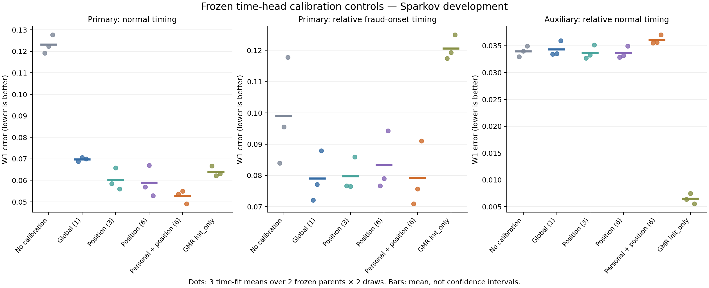

# 개인 속도 보정의 추가 가치: 단순 대조 완료 — 2026-10-01

**현재 개인 속도·위치 보정은 단순 대조보다 정상 시간 분포를 더 개선했다. 이 추가 효과는 세 시간 학습 시드 평균에서 반복됐다. 다만 같은 계수 수의 위치 보정과 비교한 이득은 한 ARGN 부모에 집중됐으며, 사기 시작 관계의 큰 회복은 단순 전역 보정에서도 나타났다.** 따라서 개인 속도 구조가 모든 관계를 추가 개선했다거나 최신 생성기보다 우수하다는 주장은 하지 않는다.

## 실행과 검증

- 기존 이력 시간망6개(시간 학습 시드3×고정 ARGN 부모2), 현재 개인 보정 C, GMR init_only를 그대로 보존했다.
- 전역1계수/위치3계수/위치6계수의 보정 학습18개 및 전체 거래열 생성36회,7,241,355행을 완료했다. 기존36출력을 합쳐72개,14,482,710행을 평가했다.
- 새 신경망/ARGN 본체/CPAR/최신 전체 생성기 학습0회다. 이번에 새 독립 ARGN 재학습이나 새로운 데이터 검증을 했다는 뜻이 아니다.
- 36개 학습·생성 작업 모두 exit0.18개 보정 최적화가 종료 조건을 충족했다(전역19–54, 위치3 96–245, 위치6 268–403평가). 전역 최적해 증명은 아니다.
- 독립 재계산828개 최대 차이9.71e-17. 이전590파일 hash,72출력의 라벨·길이,18작업의 실제 ARGN/strict-past 라우팅 검증을 통과했다.18새 head에서 보정 계수 이외의 모든 저장 tensor가 원본과 동일했다.
- GPU0–3 모두 반환. 기존 MPS PID1059805만 남았고 사용률0%. 실행 중 작업, 모델 교체,commit,push,test-event 조회 없음. inner HEAD0d620a97 유지.

## 고정된 주목표 결과

낮을수록 좋은 오류. 각 값은 기존 시간 학습 시드3×부모2×생성 난수2의12출력 평균이다.

| 동일 이력망 위의 시간 출력 | 정상 시간 log-W1 | 사기 시작 개인 대비 시간 W1 | 정상 개인 대비 시간 W1(보조) |
|---|---:|---:|---:|
| 보정 없음 H | .123082 | .099052 | .033969 |
| 전역 보정1계수 | .069761 | .079037 | .034294 |
| 위치 보정3계수 | .060087 | .079722 | .033693 |
| 위치 보정6계수 | .058901 | .083316 | .033655 |
| 현재 개인 속도+위치 보정6계수 C | **.052605** | .079223 | .036049 |
| 기존 GMR init_only(별도 시간망) | .063958 | .120572 | **.006468** |

C의 정상 시간 오류는 전역 대비24.6%, 중첩 위치3 대비12.5%, 같은 계수 수 위치6 대비10.7% 낮다. 세 대조 모두에서 시간 학습 시드 평균3/3 같은 방향이다.12개 개별 생성에서는 각각10/12,8/12,9/12 개선이다. 이는 모든 생성에서 승리했다는 뜻이 아니다.

사기 시작 개인 관계에서 C는 전역보다 평균 .000186 나쁘고, 위치3보다 .000499, 위치6보다 .004092 좋다. 전역·위치3 대비 모든 시간 시드에서 반복된 추가 사기 시작 이득은 없다. 따라서 H→C의 사기 시작 개선 전체를 개인 속도 구조의 고유 효과로 돌릴 수 없다. 보정은 정상 유지 법칙에만 직접 적용되므로 이 사기 시작 지표의 변화는 생성 과거·표현·개인 분모 등을 통한 간접 효과다. 그 중 어느 경로가 유일 원인인지 새로 증명하지 않았다.

## 부모별 차이와 비용

같은 계수 수 위치6→C:

| 고정 ARGN 부모 | 정상 시간 | 사기 시작 개인 시간 | 1024+ 정상 시간 |
|---|---:|---:|---:|
|20260930|.071872→.059258|.083213→.074723|.101736→.104506|
|20261001|.045930→.045953|.083418→.083724|.053780→.050024|

첫 부모에서 효과가 뚜렷하고 둘째에서는 주목표 차이가 거의 없다. 부모×시간-fit6블록 중 정상5/6,사기 시작4/6 개선이다. 시간 시드3개 평균의 반복을 서로 다른 ARGN 본체에서 일관된 우위로 확대하지 않는다. 중첩 위치3 대비 정상 시간은 두 부모 평균에서 모두 개선하지만 둘째의 차이는 작다.

정상 개인 관계는 위치6 .033655→C .036049로 나빠졌고 이 비용은 시간 시드3/3 반복된다. 초반6–49도 .093152→.105010으로 나빠졌다. 사기 상대 금액은 .104294→.099157로 좋아졌지만 정상 금액 .063217→.063400, merchant TV .067460→.067606은 소폭 나빠졌다. 전체 숫자는 MEANS.csv와 PARENT_FIT_MEANS.csv에 보존한다. 기존 GMR init_only는 정상 개인 관계에서 여전히 훨씬 좋다.

사전등록 주효과/비용 허용폭 및 시드 반복 기준은 세 단순 대조 모두에 대해 통과했다. 이는 비용이 없거나 논문 기여가 확정됐다는 뜻이 아니다. C vs GMR init_only는 이전과 같은 초반 +.02 조건을 여전히 넘는다. 기준을 소급해 바꾸지 않았다.

## 학습 점수와 생성 점수 구분

정확히 같은 실제-prefix 표본에서 이전 C 학습목적을 재계산해 매번1e-12이내 일치했다. 위치6은6블록 중4블록에서 C보다 낮은 학습목적을 달성했다. 그런데 자유 생성 주목표의 평균은 C가 더 좋다. 이 차이는 조건부 적합과 자유 생성 결과가 같지 않음을 보여주며, 학습량 부족·노출 편향·구조적 안정성 중 하나를 유일 원인으로 확정하는 증거는 아니다. 위치3은 한 블록에서 그 모델을 포함하는 C보다 더 낮은 학습목적을 얻었으므로, 제한된 Powell 탐색의 결과를 함수족 표현력의 한계로 해석하지 않는다.

## 유지할 연구 주장과 다음 비교

현재 근거에 맞는 후보는 다음과 같다.

> **같은 이력 조건부 거래 생성기에서, 단순 시간 보정으로 회복한 사기 시작의 개인 대비 시간 관계를 대체로 유지하면서, 개인 속도와 진행 위치를 함께 사용하는 보정이 정상 시간 분포를 추가 개선한다.**

명시적 속도를 제거한 곳은 보정식뿐이다. 모든 대조의 이력망은 여전히 고객 이력을 사용한다. 따라서 이 결과를 고객 이력 자체의 필요성 검증이나 새 거대 생성기의 효과라고 설명하지 않는다. 보정·조건부 혼합·위치 보간 자체의 신규성도 확정하지 않는다.

등록 기준을 통과했으므로 이 작은 추가 효과를 최신/전체 생성기 비교에서 검증할 근거가 생겼다. 다음 비교에는 **C와 위치6 단순 대조를 함께 유지**해야 한다. CPAR/MeLD보다 C가 좋아도 단순 보정도 같은 수준으로 좋다면 그 전체 차이를 개인 속도 구조의 고유 기여로 계산하지 않는다. 공통 고객 지원, 제공된 조건/거래열 길이, 모든 생성 필드, 학습·선택 예산을 먼저 일치시키고 CPAR의 기존143명 지원과 MeLD의120방문 설정을 그대로 우리147명/긴 거래열과 비교하지 않는다. 그 전체 생성기 적용·학습·검증은 이번 완료 범위가 아니다.

현재 C와 유용한 대안 모두 보존한다. 추가 보정식을 만들거나 현재 방법을 다시 조정하지 않았다. 반복 사용한 development 결과이므로, 최종 기여에는 가까운 최신 방법과의 대조 및 미사용 자료 검증이 남는다.

원문 근거와 해석 범위: [READING_AND_SCOPE.md](READING_AND_SCOPE.md), 등록조건: [PROTOCOL.md](PROTOCOL.md), 수치검증: [FINAL_AUDIT.json](FINAL_AUDIT.json).
