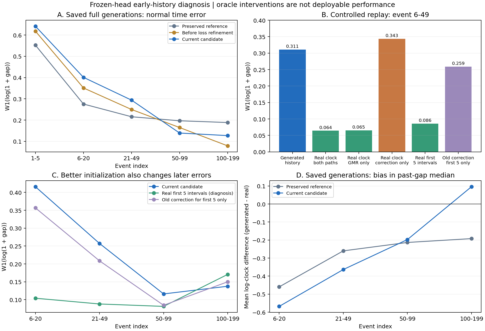

# 최신 personal_six의 초반 거래 오류 진단 완료 — 2026-09-28

진단 대상은 최신 `argn_clock_stratified_loss_v1/personal_six`다. 이전 모델은 대조에만
사용했다. **현재 후보는 초기 간격을 너무 짧게 생성하고, 그 간격에서 계산한 개인 속도를
다음 시간 출력에 다시 넣으면서 초반 오류를 유지한다.** 실제 과거에서 계산한 속도를
제공하면 오류가 크게 줄어든다. 이번 결과는 초기 출력·속도 형성과 이후 반복 입력의
연결을 다음 수정 지점으로 지지한다. ARGN 전체의 구조적 한계나 새로운 기여의 증명은 아니다.

여기서 초반은 **고객 거래열의 초반**이며 사기 발생 시점인 onset과 다르다.
거래 위치는 코드의 0-based event_index이고, 0의 gap은 거래간격으로 평가하지 않는다.

## 실행과 보존

- 저장된 5개 head의 전체 생성 파일 40개를 읽고, 원래 6–49 오류 32개를 정확히 재계산했다.
- 학습용 619명, 내부 검증 69명, 개발 147명의 실제 라벨 경로를 고정했다.
- 기존 2개 부모 × 4개 생성 라벨 경로도 사용했다. 고객과 위치의 공통 지원집합에서 비교했다.
- 총 **426개 짧은 시간 출력 재생**, 14,138,474개 평가 대상 시간값을 계산했다.
  이는 426개 새 모델 학습이나 전체 거래 데이터 생성이 아니다.
- CPU에서 동일 조건부 분포를 계산했다. Torch와 독립 NumPy 모수의 최대 차이는
  1.78e-15였고, 이전 actual-prefix 재생과 정수 간격 출력도 정확히 일치했다.
- 새 학습·GPU 전체 생성·최종 test 사용·모델 교체·commit/push는 없다.
  기존 전체/후반 개선과 금액 등의 비용이 포함된 원본 결과를 그대로 보존했다.

실제 경로의 정상 6–49 표본은 optimization 24,791행/570명, internal 2,890행/66명,
development 5,884행/135명이다. 생성 라벨 대조에서는 두 경로 모두 정상인 공통 위치를
사용하며, 8개 경로의 지원은 5,169–5,672행/121–132명이다. 나머지 고객은 사기 라벨이나
짧은 길이 때문에 이 특정 정상 구간 지표에 들어가지 않으며 임의로 제외한 것이 아니다.
지원집합은 같은 경로의 모든 모델·개입에서 동일하다.

## 1. 원래 생성 결과에서도 초기에 간격이 너무 짧다

8개 기존 생성의 정상 gap W1(log1p gap) 평균이다. 낮을수록 좋다.

| 거래 위치 | 보존 clock_prefix | 손실 세분화 전 personal | 현재 refined personal |
|---|---:|---:|---:|
| 1–5 | 0.552820 | 0.618590 | 0.641871 |
| 6–20 | 0.275455 | 0.351236 | 0.401077 |
| 21–49 | 0.215591 | 0.249750 | 0.293794 |
| 6–49 전체 | 0.236051 | 0.284870 | 0.331035 |
| 50–99 | 0.196623 | 0.164789 | 0.138912 |
| 100–199 | 0.188436 | 0.078463 | 0.126845 |

첫 1–5 정상 간격의 실제 중앙값은 평균 35,264초(약 9.8시간), 현재 생성은 18,445초
(약 5.1시간)다. 각 생성의 공통 지원집합에서 구한 중앙값의 평균이며, 특정 개인의
미래 간격을 그대로 복제해야 한다는 뜻이 아니다. 6–20의 생성 개인 속도 기준인
과거 간격 중앙값도 실제보다 작다(평균 log-clock 차이 -0.568).

코드상 이전 유효 간격이 5개 미만이면 개인 속도는 모두 fallback **16,535초**다.
이 시간 head의 GMR은 사기 전환 상태와 이 속도만 사용하며, native ARGN의 고객/이력
벡터를 사용하지 않는다. 전체 ARGN의 모든 출력이 고객 정보를 무시한다는 뜻은 아니다.
event_index 6에서 처음 5개의 생성 간격으로 개인 속도를 계산하기 시작한다.
21부터 최근 20개 간격을 사용한다. 6–49에서는 유효 이력 부족 비율이 0이므로,
이 구간까지 fallback이 계속 적용되는 구현 오류는 아니었다.

초기 정상 유지 상태의 log-gap 보정량은 이전 personal 0.222927 → 현재 0.199253으로
작아졌다. 현재 보정은 위치 1–25에서 같은 위치 기저를 공유하므로 초기 1–5만을 위한
독립 계수가 없다. 200+ 손실 세분화 후 공유 계수를 재적합하면서 초기 출력도 달라진 것이다.
손실 구간을 세분화했다고 초반 출력이 자동으로 보존되는 구조는 아니었다.

## 2. 실제 속도 입력으로 바꾸면 초반 오류가 크게 줄어든다

현재 head를 고정하고, 같은 난수·라벨·길이에서 속도 입력만 바꿨다. 아래 값은
**통제한 시간 출력 재생**이므로 원래 전체 생성 점수 0.331035와 같은 수치가 아니다.
실제 과거 입력은 원인 진단용이며 배포 가능한 생성 성능으로 보고하지 않는다.

| 개인 속도 입력 대조 | 개발 실제 라벨 경로, 4 noise | 개발 생성 라벨 경로, 8경로×2 noise |
|---|---:|---:|
| 모두 자체 생성 과거 사용(GG) | 0.277423 | 0.310977 |
| 기본 GMR과 보정 모두 실제 과거 사용(RR) | 0.066849 | 0.064375 |
| 기본 GMR만 실제 과거, 보정은 자체 과거(RG) | 0.067735 | 0.065476 |
| 보정만 실제 과거, 기본 GMR은 자체 과거(GR) | 0.312970 | 0.343385 |
| 첫 5개 실제 간격으로만 memory 구성 후 자유 진행(seed5) | 0.099086 | 0.085831 |
| 첫 1–5 보정량만 보존 clock_prefix 것으로 교체 | 0.231226 | 0.259060 |

주요 결과는 모든 개발 실제 경로 noise 4개, 생성 경로/noise 16개에서 같은 방향이다.
내부 검증에서도 GG 0.248764 → RR 0.092268, optimization에서도 0.272554 → 0.045400이다.
이는 재학습 seed 독립 반복이 아니라 **고정 head의 난수·경로 반복 대조**다.
정상 유지 NN만 따로 평가해도 개발 실제 경로 0.277901 → 0.066688로 방향이 같았다.
따라서 사기에서 정상으로 돌아오는 소수 행의 구성만으로 설명되는 현상은 아니다.

GMR 쪽 속도만 바꾸면 거의 같은 회복이 나오고, 보정 쪽만 바꾸면 오히려 악화한다.
이번 대조에서 주요 문제 경로는 **생성된 짧은 간격 → 낮아진 과거 간격 중앙값 →
그 값을 조건으로 사용하는 기본 GMR 출력**이다. 보정의 속도 의존성은 일부 상쇄하고
있으므로 이를 무작정 제거할 근거는 없다. W1의 감소량을 서로 더할 수 있는 인과 기여율로
해석하거나 실제 금융 행동의 원인이 밝혀졌다고 확대하지 않는다.

실제 속도를 계속 제공하는 6–49 대조에서는 현재 후보가 이전 personal보다도 낫다
(개발 0.073968 → 0.066849). 현재 보정이 조건부 시간 분포를 전반적으로 못 배웠다는
설명보다는 **초기 상태가 다르게 형성됐을 때의 반복 적용 문제**가 더 직접적인 근거를 얻었다.
다만 RR의 집계 오차가 작다는 것이 모든 고객 조건별 분포가 정확하다는 증명은 아니다.

첫 1–5에서는 실제 과거를 참조하는 RR도 같은 fallback을 사용하므로 GG와 출력이 같다.
여기서의 큰 오류는 아직 유효 속도가 만들어지기 전의 **초기 출력 부적합**이다.
“실제 과거를 주면 처음부터 모든 문제가 사라진다”는 결론은 잘못이다.

## 3. 초기 오류가 뒤까지 전달되지만, 수정 효과가 계속 좋아지는 것은 아니다

첫 5개 실제 간격만 memory에 주면 이후 6–49 오류가 0.310977 → 0.085831로 줄었다.
이 5개 실제 간격은 생성 성능 평가에 넣지 않았다. 또한 21 직전에 과거 20개를 실제
memory로 한 번 교체하자 21–49 오류가 0.257244 → 0.066037로 줄었다.
초기 상태가 후속 오류에 영향을 준다는 직접적인 모델 내부 대조다.

하지만 그 상태를 바로잡은 뒤에도 기존 보정을 계속 적용하면 100–199에서는 반대 비용이
나타났다. 개발 생성 라벨 경로 기준:

| 대조 | 6–49 | 100–199 |
|---|---:|---:|
| 현재 후보 그대로 | 0.310977 | 0.137504 |
| 첫 5개 실제 간격으로 memory 구성 | 0.085831 | 0.170673 |
| 첫 1–5 보정량만 이전 것으로 교체 | 0.259060 | 0.149964 |

원래 전체 생성에서도 현재 후보는 6–49에 짧은 쪽으로, 100–199에는 긴 쪽으로 치우친다
(평균 log-gap 차이 각각 -0.329, +0.124). 따라서 이 현상은 시간이 지날수록 오류가
무조건 커지는 단순한 누적오차가 아니다. 초기에 부족한 간격을 보상하던 이후 보정과
새로운 초기 상태가 맞지 않을 가능성을 지지한다. 초기화가 개선된 조건에서 후속 보정을
재학습해야 해결되는지는 아직 실험하지 않았으므로 확정하지 않는다.

기본 출력 clipping 비율은 생성 라벨 경로 6–49에서 약 0.0185%였다. 단순 출력 상한에
대량으로 걸려 발생한 문제로 보기 어렵다. 보정의 clock endpoint 밖 표본은 존재하지만
별도 endpoint 개입은 하지 않았으므로 그 기여까지 분리했다고 하지 않는다.

## 다음 수정 지점과 채택 조건

다음 대상은 **초기 거래에서 개인 속도가 형성되는 방식과 이후 시간 보정의 연결**이다.
첫 5개를 강제로 실제 값으로 채우거나 전체 간격을 일정 배율로 늘리는 것을 해법으로
채택하지 않는다. 실제 과거를 제공한 결과는 개선 여지와 위치를 찾는 진단이다.

학습자료의 초기 거래에 맞춘 간단한 초기 출력으로 충분한지부터 확인하고, 필요한 경우
기존 고객 조건을 쓰는 초기 출력과 비교하는 순서가 타당하다. 현재 후속 head를 고정한
대조와 초기 변화에 맞춰 후속 보정을 학습한 대조를 구분해야 한다. 구체 학습법·예산은
가장 가까운 선행과 대응시킨 새 프로토콜에서 정하고, 이번 진단 결과에 끼워 넣지 않는다.

초반 개선과 함께 전체 정상 시간·1024+ 시간·사기 onset 개인 속도 관계·개인 대비 사기
금액·사기율·정상 품질·다양성을 다시 확인해야 한다. 이번 짧은 시간-only 개입으로
1024+나 금액 비용이 보존된다고 주장할 수 없다. 기존 후보의 전체 정상 0.052838,
1024+ 0.079196 결과는 **모델을 변경하지 않았으므로 그대로 보존**되어 있을 뿐이다.

현재 활성 모델은 계속 `clock_prefix`이며 refined personal은 유망한 로컬 후보다.
새 초기 출력의 학습이나 전체 길이 검증은 아직 실행하지 않았다. 진단 단계는 완료됐다.

## 선행과 이번 진단의 관계

[Preserving Temporal Dynamics in Time Series Generation (2026), §III-B/IV](https://arxiv.org/html/2604.27182v1)는
시간 조건부 법칙과 생성 조건 분포를 구분한다. 이 관점을 입력/출력 대조에 사용했다.
해당 논문의 Algorithm 1은 실제 시계열 s_t를 참조하므로 그 MCMC를 그대로 자유 생성에
도입하지 않았고, 논문의 Wasserstein 하한이나 정상성 가정을 우리 거래열에 적용하지 않았다.

[He et al., EMNLP 2021, §4–5](https://aclanthology.org/2021.emnlp-main.415.pdf)는
실제 prefix와 모델 prefix를 바꿔 후속 생성을 비교한다. 이번 실제 history 교체와
회복 여부 확인은 그와 같은 알려진 진단 원리다. 해당 언어 모델의 회복 결론을 거래열에
옮기지 않고 직접 측정했다. 이번 진단을 새 방법의 기여나 최신 생성기 대비 우월성으로
표현하지 않는다.

## 감사 기록과 파일

최초 기존 점수 대조에서 start=6만 선택해 6–20과 6–49가 섞인 오류는
[AMENDMENT1.md](AMENDMENT1.md)에, 생성 라벨 대조의 record 순번/원래 고객 ID 연결
오류는 [AMENDMENT2.md](AMENDMENT2.md)에 보존했다. 두 오류 모두 결과 채택 전에
검사에서 중단됐고, frozen 소스·원래 모델·원래 생성 파일을 수정하지 않았다.
후자는 기존 positions의 공식 매핑과 147명 전체의 위치/라벨, 이번 horizon의 gap 일치로
검증했다. 완료된 실제 경로 재생은 그대로 재사용했다.

- [입력 고정 및 개입 계획](PROTOCOL.md)
- [구현 검사](IMPLEMENTATION_CHECK.json), [기존 점수 재현](SAVED_RESULTS_CHECK.json)
- [고객 매핑 검사](ENTITY_MAPPING_CHECK.json), [완료 집계](COMPLETE.json)
- [개입 결과](early_interventions_summary.csv), [반복별 변화](paired_intervention_changes.csv)
- [원래 생성 구간 결과](saved_generation_means.csv), [표본 수](support_counts.csv)
- [진단 그림](early_history_diagnosis.pdf), [최종 보존 감사](FINAL_AUDIT.json)

